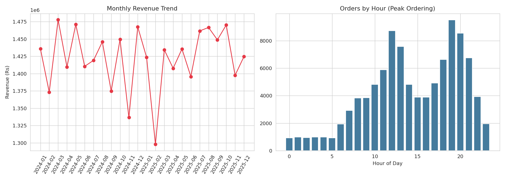
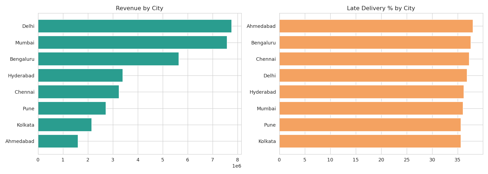

# 🍔 Food Delivery Business Analytics Platform

An end-to-end business intelligence project analyzing 100,000+ food delivery transactions —
covering revenue, customer retention, delivery operations, and business strategy — built with
**Python, PostgreSQL, and Power BI**, and deployable as a live public dashboard.




> These charts are generated directly from the dataset in this repo — run `notebooks/01_eda_and_cleaning.ipynb` to reproduce them yourself.

---

## 📊 What this project does

Rather than a single "analyze the CSV" script, this is a full analytics stack answering real
business questions across four areas:

| Area | Example questions answered |
|---|---|
| **Revenue** | Monthly revenue trend, AOV, revenue by city/restaurant/category, MoM growth |
| **Customer** | New vs. returning customers, retention rate, CLV, repeat purchase rate, RFM segmentation |
| **Operations** | Avg delivery time, late-delivery %, delivery partner performance, peak ordering hours |
| **Business** | Effect of discounts on revenue, most profitable restaurants, highest-growth cities |

All 19 KPI queries live in [`sql/03_analysis_queries.sql`](sql/03_analysis_queries.sql), organized
by section.

---

## 🏗️ Architecture

```
Raw Data (generated)
       ↓
Python / Pandas + NumPy   →  src/generate_data.py, src/data_cleaning.py
       ↓
Data Cleaning + EDA       →  notebooks/01_eda_and_cleaning.ipynb
       ↓
PostgreSQL                →  sql/01_schema.sql, sql/02_load_data.sql
       ↓
SQL Analysis (19 KPIs)    →  sql/03_analysis_queries.sql
       ↓
Power BI Dashboard        →  powerbi/POWERBI_GUIDE.md
       ↓
Business Insights
```

A parallel path (`app.py`) rebuilds the same KPIs as a public **Streamlit** web dashboard, since a
Power BI report normally needs a login to view — see [Deployment](#-deployment) below.

---

## 🛠️ Tech Stack

- **Python** — Pandas, NumPy (data generation, cleaning), Matplotlib/Seaborn (EDA)
- **SQL** — PostgreSQL 16 (schema design, indexing, window functions, RFM segmentation)
- **BI** — Power BI (DAX measures, multi-page interactive dashboard)
- **Deployment** — Docker Compose (PostgreSQL), Streamlit Community Cloud (public dashboard)
- **Tooling** — Jupyter Notebook, Git/GitHub

---

## 📁 Project Structure

```
food-delivery-analytics/
├── README.md                      ← you are here
├── requirements.txt
├── docker-compose.yml             ← containerized PostgreSQL
├── app.py                         ← public Streamlit dashboard
├── .gitignore
│
├── data/
│   ├── raw/                       ← generated raw CSVs (customers, restaurants, partners, orders)
│   └── processed/                 ← cleaned, analysis-ready CSVs
│
├── src/
│   ├── generate_data.py           ← synthetic dataset generator (100K+ orders)
│   └── data_cleaning.py           ← handles nulls, bad values, duplicates
│
├── notebooks/
│   └── 01_eda_and_cleaning.ipynb  ← exploratory data analysis + visualizations
│
├── sql/
│   ├── 01_schema.sql              ← PostgreSQL DDL (tables, FKs, indexes)
│   ├── 02_load_data.sql           ← \copy commands to load cleaned CSVs
│   └── 03_analysis_queries.sql    ← 19 KPI queries: Revenue / Customer / Ops / Business
│
├── powerbi/
│   └── POWERBI_GUIDE.md           ← step-by-step dashboard build guide + DAX measures
│
├── docs/
│   └── DEPLOYMENT.md              ← 3 deployment options (local / Docker / public web)
│
└── assets/                        ← chart exports for this README
```

---

## 🚀 Quick Start

```bash
git clone https://github.com/<your-username>/food-delivery-analytics.git
cd food-delivery-analytics
pip install -r requirements.txt

# 1. Generate the dataset (100K orders, 12K customers, 600 restaurants, 1.5K delivery partners)
python src/generate_data.py --orders 100000

# 2. Clean it
python src/data_cleaning.py

# 3. Spin up PostgreSQL (Docker) and load the data
docker compose up -d
psql -h localhost -U postgres -d food_delivery_db -f sql/01_schema.sql
psql -h localhost -U postgres -d food_delivery_db -f sql/02_load_data.sql

# 4. Run the KPI queries
psql -h localhost -U postgres -d food_delivery_db -f sql/03_analysis_queries.sql

# 5. (Optional) run the public dashboard locally
streamlit run app.py
```

Full details, including a no-Docker path and the Power BI connection steps, are in
[`docs/DEPLOYMENT.md`](docs/DEPLOYMENT.md) and [`powerbi/POWERBI_GUIDE.md`](powerbi/POWERBI_GUIDE.md).

---

## 🌐 Deployment

See [`docs/DEPLOYMENT.md`](docs/DEPLOYMENT.md) for full instructions. Summary:

1. **Local** — PostgreSQL + Power BI Desktop on your machine (fastest to demo).
2. **Docker** — `docker-compose.yml` containerizes PostgreSQL; deployable to any cloud host.
3. **Public web dashboard** — `app.py` (Streamlit) deployed free on
   [Streamlit Community Cloud](https://streamlit.io/cloud) — gives you **one link, no login**, that
   recruiters can open instantly. **This is the link to put on your resume.**

---

## 📈 Key Findings (from this dataset)

- Revenue is concentrated in a handful of top cities and food categories.
- ~80% of orders come from repeat customers on this dataset — retention matters more than pure
  acquisition volume.
- Late deliveries measurably correlate with lower customer ratings, tying operations performance
  directly to satisfaction and retention.
- Ordering volume peaks sharply during lunch (12–1 PM) and dinner (7–9 PM) hours — a direct input
  for delivery partner staffing decisions.

---

## 📝 Resume Bullets

```
Food Delivery Business Analytics Dashboard | Python, PostgreSQL, Power BI, Streamlit

• Engineered a full analytics pipeline processing 100K+ food delivery transactions using
  Python/Pandas and PostgreSQL, from raw data generation through cleaning to a normalized
  4-table relational schema.
• Wrote 19 SQL-based KPI queries (window functions, CTEs, RFM segmentation) covering revenue,
  customer retention, delivery operations, and business strategy.
• Built an interactive multi-page Power BI dashboard with custom DAX measures tracking revenue,
  AOV, retention, and delivery performance across 8 cities.
• Performed RFM-based customer segmentation and cohort retention analysis to identify
  high-value customer segments, informing targeted retention strategy.
• Containerized the database layer with Docker and deployed a public Streamlit dashboard,
  demonstrating full-stack ownership from data pipeline to live deployment.
```

Adjust numbers/tools to match what you actually ran — the strength of this bullet set is the
*measurable outputs* (100K+ transactions, 19 KPIs, 8 cities), not the tool names alone.

---

## 📄 License

This project uses fully synthetic, generated data — no real customer or business data is included.
Free to use as a portfolio/resume project.
